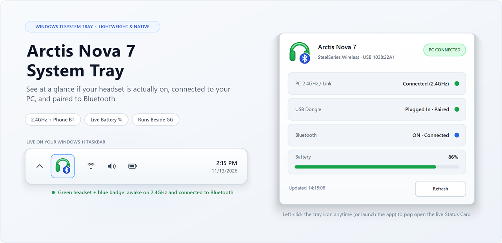

# Arctis Nova 7 & Wireless Family System Tray



**[Download v1.3.0](https://github.com/JReames/arctis-nova-tray/releases/latest)** · **[Website & Visual Overview](https://jreames.github.io/arctis-nova-tray/)** · **[Visual Guide](docs/VISUAL-GUIDE.md)** · **[MIT License](LICENSE)** · **Windows 11 (.NET 9, zero external packages)**

---

## Why I Built This (Works With or Without SteelSeries GG)

If you use a SteelSeries Arctis Nova 7 (or Nova 5, Nova 3P/3X Wireless, Nova Pro Omni, or Arctis GameBuds) with its wireless USB receiver on Windows 11, Windows has one annoying habit: as long as that receiver stays plugged in, Windows claims your headphones are "connected" even when the headset is turned off on your desk. You only find out otherwise when audio vanishes into thin air, or when you realize the next morning that you forgot to power the headset off.

On top of that, Windows gives you no native taskbar indicator showing how much battery percentage you have left, or whether your Nova 7 is simultaneously paired to your phone over Bluetooth, without installing and opening the full SteelSeries GG suite.

**Arctis Nova System Tray** puts a tiny, crisp status indicator right next to your Windows 11 clock:
- **Works with or without SteelSeries GG**: Talks directly to the USB wireless receiver through the built-in Windows `HidUsb` (`input.inf`) driver on clean PCs without GG installed, and shares the receiver peacefully alongside SteelSeries GG and Sonar when GG is running.
- Shows whether your headset or earbuds are **actually powered on** over 2.4 GHz wireless or sitting off while the USB receiver stays plugged in, with adaptive dark and light taskbar contrast.
- Shows **Bluetooth status** in the corner of the icon (including simultaneous **phone** Bluetooth on Nova 7 Gen 2 / 2026 refresh hardware, plus native Windows PC Bluetooth fallback across all Arctis Nova models).
- Shows **live battery percentage, charging state, and hardware mic-mute status** (where supported by receiver firmware) on hover or with a single left-click.
- Includes an **opt-in Start with Windows setting** right inside the Status Card and right-click tray menu (starts quietly with `--silent` when enabled), and writes nothing to `%APPDATA%` or the registry unless you turn `Start with Windows` on (`HKCU\Software\Microsoft\Windows\CurrentVersion\Run\ArctisNovaTray`).

---

## Get Running in 30 Seconds

> **Prerequisite**: [.NET 9 Windows Desktop Runtime](https://dotnet.microsoft.com/download/dotnet/9.0) (already installed on most developer machines with .NET 9).

1. **Download & unzip**: Grab **`ArctisNovaTray-v1.3.0-win-x64.zip`** from the [Releases page](https://github.com/JReames/arctis-nova-tray/releases/latest) and extract it anywhere you keep utilities.
2. **Launch it**: Double-click **`ArctisNovaTray.exe`** (or run `.\Start-ArctisNovaTray.ps1`). The light-mode Status Card pops open in the bottom-right corner right after the first hardware check so you know it is running.
3. **Pin the icon once**: Click the **`^`** hidden-icons arrow near your Windows 11 clock and drag the headset icon onto your taskbar so it stays visible all day.

Left-click the tray icon anytime to open the Status Card (`Tab`, `F5`, and `Esc` work from the keyboard) and toggle **Start with Windows** if you want it to launch automatically when you sign in. Hover for a quick model-aware text summary (`Nova 7: PC 2.4 GHz | BT Connected | 86%`), or right-click to check status, refresh, toggle startup, or exit.

---

## At-a-Glance Windows 11 Taskbar Visual Guide

Two visual layers tell the whole story on both dark and light Windows 11 taskbars: the **headset color** shows your PC connection, and the **bottom-right badge** shows Bluetooth.


| Icon | State | What It Means |
| :---: | :--- | :--- |
|  | **PC + Bluetooth Connected** | Headset is awake on 2.4 GHz (or PC Bluetooth) and connected to your phone or PC over Bluetooth. |
|  | **PC Connected, Bluetooth Waiting** | Headset is awake on 2.4 GHz. Bluetooth on the headset is switched on, waiting to connect. |
|  | **PC Connected Only** | Headset is awake on 2.4 GHz wireless, and Bluetooth is off (or not reported over the 2.4 GHz dongle). |
|  | **Headset Off, Receiver Plugged In** | USB receiver is plugged into your PC, **but the headset or earbuds are powered off or asleep**. |
|  | **Disconnected** | USB receiver is unplugged and no SteelSeries Arctis Nova headset is connected to this PC over Bluetooth. |

Want the full tour of the popup Status Card, taskbar pinning tips, and everyday scenarios? Visit the **[Website & Visual Overview](https://jreames.github.io/arctis-nova-tray/)** or read the **[Visual Guide](docs/VISUAL-GUIDE.md)**.

---

## Supported SteelSeries Arctis Nova Wireless Models (22 USB PIDs)

Supports **22 wireless USB receiver PIDs** across the modern SteelSeries Arctis Nova family (`VID_1038`), plus direct Windows Bluetooth connections when used without a USB receiver.

Each USB PID carries an explicit verification tier:
- **`Hardware-Verified`**: Tested directly against a physical receiver and headset on Windows 11.
- **`Community-Spec`**: Implemented from open-source HID protocol specifications ([Sapd/HeadsetControl](https://github.com/Sapd/HeadsetControl) and [marctew/arctis-nova-pro-omni-tray-tool](https://github.com/marctew/arctis-nova-pro-omni-tray-tool)) and covered by deterministic unit tests. Own one of these models? Paste your `--status-json` output in a **[Hardware Verification Report](.github/ISSUE_TEMPLATE/hardware-verification.md)** to promote your PID to `Hardware-Verified`!

| Protocol Family | Supported Models & USB PIDs (`VID 0x1038`) | Verification Tier | Reported Telemetry |
| :--- | :--- | :--- | :--- |
| **Arctis Nova 7 (2026 Refresh)** | **Arctis Nova 7** (`0x22A1`) | **`Hardware-Verified`** | 2.4 GHz awake/off, 0-100% battery, charging, phone or PC Bluetooth state, and mic mute |
| **Arctis Nova 7 Gen 2 / Refresh** | **Nova 7 Wireless Gen 2** (`0x227E`), **Nova 7P Gen 2** (`0x22A7`, `0x2298`), **Nova 7X Gen 2** (`0x2258`, `0x229E`, `0x22AD`), **Nova 7X** (`0x22A5`), **Diablo IV Edition** (`0x22A9`) | `Community-Spec` | 2.4 GHz awake/off, 0-100% battery, charging, phone or PC Bluetooth state, and mic mute |
| **Arctis Nova 7 (Original Gen 1)** | **Arctis Nova 7** (`0x2202`), **Nova 7P** (`0x220A`), **Nova 7X** (`0x2206`, `0x22A4`), **Diablo IV Edition** (`0x223A`), **World of Warcraft Edition** (`0x227A`) | `Community-Spec` | 2.4 GHz awake/off, 0-100% battery (25% steps), charging, and PC Bluetooth fallback |
| **Arctis Nova 5 / 5X Wireless** | **Arctis Nova 5** (`0x2232`), **Arctis Nova 5X** (`0x2253`, `0x2264`) | `Community-Spec` | 2.4 GHz awake/off, 0-100% battery, charging, ChatMix bytes, and PC Bluetooth fallback |
| **Arctis Nova 3P / 3X Wireless** | **Arctis Nova 3P Wireless** (`0x2269`), **Arctis Nova 3X Wireless** (`0x226D`) | `Community-Spec` | 2.4 GHz awake/off, 0-100% battery, charging, and PC Bluetooth fallback |
| **Arctis GameBuds** | **Arctis GameBuds** (`0x230A`) | `Community-Spec` | 2.4 GHz active vs docked in case, minimum active L/R earbud battery (0-100%), and PC Bluetooth fallback |
| **Arctis Nova Pro Omni** | **Arctis Nova Pro Omni GameHub** (`0x2290`) | `Community-Spec` | 2.4 GHz awake/off (`ReportId 0x01`), 0-100% battery, charging, mic mute, and PC Bluetooth fallback |

---

## Common Questions

**Does this work without SteelSeries GG installed or running?**
Yes. It queries the SteelSeries USB wireless receiver firmware directly over the built-in Windows `HidUsb` (`input.inf`) driver using shared Win32 HID handles (`FILE_SHARE_READ | FILE_SHARE_WRITE`). You do not need SteelSeries GG, Engine, or Sonar installed, and if you do run GG and Sonar, both apps work side by side without locking USB or audio devices.

**How do I tell if my Arctis Nova headset is turned off when the USB receiver stays plugged in?**
When the headset powers off or goes to sleep (or when both GameBuds are docked in their case), the receiver's `0xB0` status report updates its link state immediately. The tray icon changes from solid green to a **hollow amber headset**, the tooltip updates (for example, `Nova 7: Off or Asleep (Receiver In)`), and the Status Card hides stale cached battery numbers behind `Turn headset on to read`.

**How do I see battery percentage and phone Bluetooth status on the Windows 11 taskbar?**
Hover over the taskbar icon for an instant summary (`Nova 7: PC 2.4 GHz | BT Connected | 86%`), or left-click to open the Status Card with a color-coded battery bar. On Nova 7 Gen 2 and 2026 refresh hardware, the USB-C receiver reports the headset's Bluetooth radio directly, so the blue corner badge lights up even when your headset is connected to your phone. On all models, direct Windows PC Bluetooth connections are also detected automatically.

**Can it start automatically when I sign in to Windows?**
Yes. Flip on **Start with Windows** inside the left-click Status Card (or in the right-click tray menu). That registers `ArctisNovaTray.exe --silent` under `HKCU\Software\Microsoft\Windows\CurrentVersion\Run\ArctisNovaTray` so it starts quietly in your tray at login. Turning the switch off removes that entry cleanly.

---

## PowerShell Helpers & Options

If you prefer launching or scripting from a terminal, the included PowerShell scripts work from both the unzipped release folder and a git checkout:

```powershell
# Launch the tray app and pop open the Status Card (or bring it to the front if already running)
.\Start-ArctisNovaTray.ps1

# Launch quietly in the tray without opening the Status Card on startup (used by Start with Windows)
.\scripts\Start-ArctisNovaTray.ps1 -Silent

# Enable or disable Windows login startup registration from PowerShell
.\scripts\Start-ArctisNovaTray.ps1 -EnableStartup
.\scripts\Start-ArctisNovaTray.ps1 -DisableStartup

# Cleanly stop a running instance and start a fresh one
.\scripts\Start-ArctisNovaTray.ps1 -Restart

# Check your headset status right in PowerShell (returns a structured object, or JSON with -RawJson)
.\scripts\Get-ArctisNovaStatus.ps1
.\scripts\Get-ArctisNovaStatus.ps1 -RawJson

# Stop the running tray app cleanly (pass -DisableStartup to also remove login auto-start)
.\scripts\Stop-ArctisNovaTray.ps1
```

---

## How It Works Under the Hood

This app is plain C# (`net9.0-windows` WinForms + GDI+) talking directly to Windows (`hid.dll`, `setupapi.dll`, `cfgmgr32.dll`, `kernel32.dll`, `user32.dll`) with **zero NuGet dependencies**.

<details>
<summary><strong>USB HID protocol families, Bluetooth fallback, CLI flags, and building from source</strong></summary>

### 1. Data-Driven 2.4 GHz Receiver Probing (`Win32HidInterop` + `Nova7HidProtocol`)
- Scans SteelSeries (`VID_1038`) wireless receivers across **22 supported PIDs** on vendor control collection `UsagePage = 0xFFC0` (`Usage = 0x0001` for USB-C dongles; any `0xFFC0` usage on `0x2290` Nova Pro Omni GameHub; wired `0x22A0` excluded).
- Opens the HID path with `FILE_SHARE_READ | FILE_SHARE_WRITE` and short overlapped I/O timeouts (`<= 220ms`, reading up to 4 frames until the matching `ReportId + 0xB0` response arrives). For non-zero `ReportId` receivers (`0x2290`), falls back strictly to `HidD_SetOutputReport` if `WriteFile` is unsupported over EP0, and **never** reads or writes HID Feature reports (`FeatureReportByteLength = 1035` on `0x2290` stores hardware EQ settings).
- Decodes each family's `0xB0` status frame:
  - **Nova 7 Gen 2 & 2026 Refresh** (`0x22A1`, `0x227E`, `0x22A7`, `0x2298`, `0x2258`, `0x229E`, `0x22AD`, `0x22A5`, `0x22A9`): `[0x00, 0xB0]` (65B); `data[1] == 0x03` online, `data[2]` `0-100%` battery, `data[3]` charging, `data[6]` headset Bluetooth state (`0x00` Off, `0x03` Waiting, `0x02` Connected), `data[9]` mic mute.
  - **Nova 7 Original Gen 1** (`0x2202`, `0x2206`, `0x22A4`, `0x220A`, `0x223A`, `0x227A`): `[0x00, 0xB0]` (65B); `data[1] == 0x03` online, `data[2]` `0-4` discrete battery steps (`* 25%`), `data[3]` charging.
  - **Nova 5 / 5X** (`0x2232`, `0x2253`, `0x2264`) & **Nova 3P / 3X Wireless** (`0x2269`, `0x226D`): `[0x00, 0xB0]` (65B); `data[1] != 0x02 && != 0x00` online, `data[3]` `0-100%` battery, `data[4] == 0x01` charging.
  - **Arctis GameBuds** (`0x230A`): `[0x00, 0xB0]` (65B); `data[3] == 0x03` left active, `data[4] == 0x03` right active, minimum active earbud battery across `data[5]` and `data[6]`.
  - **Arctis Nova Pro Omni** (`0x2290`): `[0x01, 0xB0]` (64B); `reply[14] == 0x08` online, `reply[6]` battery (`>= 99` mapped to `100%`), `reply[15] == 0x02` charging, `reply[9] == 0x01` mic muted.

### 2. Native Windows Bluetooth Fallback (`Win32BluetoothProbe`)
- Queries `BTH\DEV_*` and `BTHLE\DEV_*` PnP device nodes in-process through `cfgmgr32.dll` (`DEVPKEY_Device_FriendlyName` and `DEVPKEY_Device_IsConnected`) matching `Nova`, `Arctis`, `GameBuds`, and `SteelSeries`.
- Tracks direct PC Bluetooth connections even when no 2.4 GHz USB receiver is plugged in.

### 3. Low-Overhead Refresh & Safety Guards
- Polls in the background every `2.5s` and reacts immediately to `WM_DEVICECHANGE` USB and Bluetooth hotplug events.
- Caches rendered `HICON` handles per visual state and destroys raw `Bitmap.GetHicon()` handles immediately so background polling leaks zero GDI objects.
- Checks `FindWindowW("Shell_TrayWnd", null)` before acquiring `Local\ArctisNovaTray_SingleInstance_v1` (returning exit code `3` if no interactive desktop taskbar exists, unless `--allow-headless` is passed for automated tests).

### 4. CLI Diagnostic Flags & Building from Source

```powershell
# Build Debug and Release completely offline (0 warnings, 0 errors)
dotnet build .\ArctisNovaTray.sln -c Debug
dotnet build .\ArctisNovaTray.sln -c Release

# Run the 18-case deterministic unit, protocol, pixel-contrast, startup, and live-hardware test suite
dotnet run --project .\tests\arctis-nova-tray-tests\ArctisNovaTray.Tests.csproj -c Release

# Probe live hardware JSON directly from the WinExe (pipe to Out-String so PowerShell waits)
& .\src\arctis-nova-tray\bin\Release\net9.0-windows\ArctisNovaTray.exe --status-json | Out-String

# Manage or inspect Windows login startup registration from the CLI
& .\src\arctis-nova-tray\bin\Release\net9.0-windows\ArctisNovaTray.exe --startup-status | Out-String
& .\src\arctis-nova-tray\bin\Release\net9.0-windows\ArctisNovaTray.exe --enable-startup | Out-String
& .\src\arctis-nova-tray\bin\Release\net9.0-windows\ArctisNovaTray.exe --disable-startup | Out-String

# Export all 5 canonical tray icon states at 16x16, 32x32, and 64x64 PNGs
& .\src\arctis-nova-tray\bin\Release\net9.0-windows\ArctisNovaTray.exe --export-icons .\artifacts\icons | Out-String

# Regenerate documentation diagrams and inline 48x48 icons in docs/images/
dotnet run --project .\tests\arctis-nova-tray-tests\ArctisNovaTray.Tests.csproj -c Release -- --generate-docs .
```

</details>

---

## License

Released under the [MIT License](LICENSE).
