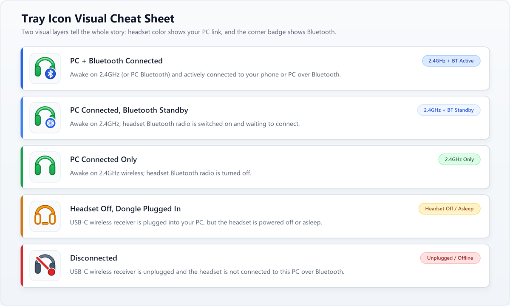
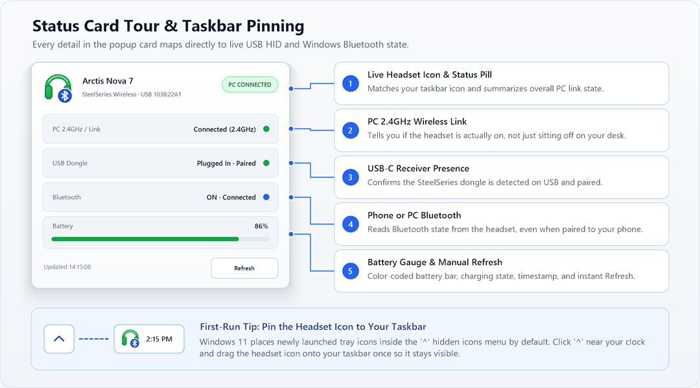

# Arctis Nova 7 System Tray: Visual Guide

[Back to README](../README.md)

This guide walks through every icon state, what each row in the popup Status Card means, how to pin the icon to your Windows 11 taskbar, and what you will see in everyday use.

---

## How the Two Icon Layers Work

Instead of forcing you to memorize cryptic symbols, the taskbar icon combines two simple visual layers:

1. **The Headset Color (Your PC Audio Link)**:
   - **Solid Green**: Your headset is powered on and actively linked to your PC (over the 2.4GHz USB-C receiver, or directly over Windows Bluetooth).
   - **Hollow Amber**: The USB-C wireless receiver is plugged into your PC, so Windows still sees an audio endpoint, **but the headset itself is turned off, asleep, or out of range**.
   - **Slate Gray with Red Slash**: The USB-C wireless receiver is unplugged and the headset is not connected to this PC over Bluetooth.
2. **The Bottom-Right Badge (Your Bluetooth Radio)**:
   - **Solid Bright Blue Badge**: Bluetooth is switched on and actively connected to a device (your phone, tablet, or PC).
   - **Hollow Blue Ring**: Bluetooth is switched on inside the headset, sitting in standby and waiting to connect.
   - **No Badge**: Bluetooth on the headset is turned off.

### All Five Taskbar Icon States

| Icon | State | Headset Base | Corner Badge | What It Means in Plain English |
| :---: | :--- | :--- | :--- | :--- |
|  | **PC + Bluetooth Connected** | Solid green | Solid blue dot | Headset is awake on 2.4GHz (or PC Bluetooth) and also connected to your phone or PC over Bluetooth. |
|  | **PC Connected, Bluetooth Standby** | Solid green | Hollow blue ring | Headset is awake on 2.4GHz. Its Bluetooth radio is on, but nothing is currently connected to it. |
|  | **PC Connected Only** | Solid green | *(Hidden)* | Headset is awake on 2.4GHz wireless, and Bluetooth on the headset is turned off. |
|  | **Headset Off, Dongle Plugged In** | Hollow amber | *(Hidden)* | Your USB-C receiver is plugged into the PC, **but the headset is powered off or asleep**. |
|  | **Disconnected** | Slate gray + red slash | *(Hidden)* | The USB-C receiver is unplugged and the headset is not connected to this PC over Bluetooth. |

---

## Reading the Popup Status Card

Left-click the tray icon at any time (or run `ArctisNovaTray.exe` / `Start-ArctisNovaTray.ps1` again) to open the Status Card right above your system clock. Pressing `Esc` or clicking anywhere outside dismisses it.

1. **Live Headset Icon & Status Pill**: Mirrors your current taskbar icon alongside an instant status pill (`PC CONNECTED`, `PC BLUETOOTH`, `HEADSET OFF`, or `DISCONNECTED`), plus the detected USB device ID (`1038:22A1` on 2026 refresh hardware, `1038:2202` on original Nova 7, and 13 other family variants).
2. **PC 2.4GHz / Link**: Shows whether the wireless audio link to your headset is actually live (`Connected (2.4GHz)` or `Connected (PC BT)`) versus sitting idle while the headset is powered down (`Headset Off / Sleeping`).
3. **USB Dongle**: Confirms whether the SteelSeries USB-C transmitter is physically plugged in (`Plugged In · Paired`, `Plugged In · Standby`, or `Unplugged`).
4. **Bluetooth**: Reports the headset's own Bluetooth state (`ON · Connected`, `ON · Connected (PC)`, `ON · Standby`, or `OFF`). On Gen 2 / 2026 refresh firmware, the USB-C dongle reports this directly from the headset, so you can see when your headset is paired to your phone!
5. **Battery Gauge & Refresh**: Shows the real battery percentage (green at 35%+, amber at 15-34%, red below 15%, and blue while charging), the last poll timestamp, and a manual **Refresh** button (`F5` works too). When the headset is turned off, stale battery numbers cached by the USB receiver are hidden so you never get a fake `100%` reading.

---

## First Launch & Pinning to the Windows 11 Taskbar

Windows 11 tucks newly launched tray icons inside its hidden-icons menu by default. Taking five seconds to pin it keeps the headset indicator right next to your clock permanently:

1. **Launch the app**: Run `ArctisNovaTray.exe` (or `.\Start-ArctisNovaTray.ps1`). Right after the first hardware check finishes, the Status Card pops open in the bottom-right corner of your screen so you know it is running.
2. **Open hidden icons**: Click the small **`^`** chevron button just to the left of your Wi-Fi, volume, and battery icons on the Windows 11 taskbar.
3. **Drag to pin**: Click and hold the **Arctis Nova 7 headset icon**, drag it down onto your taskbar next to the system tray icons, and let go.

Windows remembers your pin choice across restarts. If you ever prefer to launch the app at login without popping open the Status Card on startup, pass `--silent` (or `.\Start-ArctisNovaTray.ps1 -Silent`).

---

## Everyday Scenarios

### Gaming on PC + Phone Calls on Bluetooth
You turn on the headset with the power button for 2.4GHz PC audio, and your phone automatically reconnects to the headset over Bluetooth.
- **What you see**:  **Green headset with a solid blue corner badge**.
- **Hover tooltip**: `Nova 7: PC 2.4GHz | BT Connected | 86%`
- **Why it helps**: You know before starting a game or call that both your PC audio and phone Bluetooth link are live, along with your real battery level.

### Headset Turned Off Overnight
You hold the power button to shut the headset off at the end of the day, leaving the USB-C wireless receiver plugged into your desktop. Windows itself still claims "Headphones (Arctis Nova 7)" is connected and happily routes audio into thin air.
- **What you see**:  **Hollow amber headset**.
- **Hover tooltip**: `Nova 7: Headset Off (Dongle In)`
- **Why it helps**: One glance at the taskbar tells you why you are not hearing audio from your speakers, and reminds you whether you actually remembered to turn the headset off so the battery does not drain overnight.

### Laptop Mode Without the USB Dongle
You leave the USB-C wireless receiver plugged into your desktop dock and pair the Arctis Nova 7 directly to your Windows laptop over Bluetooth.
- **What you see**:  **Green headset with a solid blue corner badge** when connected (`PC BLUETOOTH` pill in the Status Card), switching to  **Slate gray with red slash** as soon as you turn the headset off.
- **Why it helps**: Even without the USB-C dongle present, the app checks native Windows Bluetooth PnP connection state so the tray icon still tracks your headset accurately.
